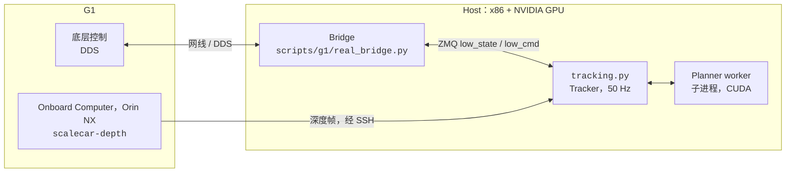

# Scalecar 进车部署

本教程用 sim2real 自己的运行时，把 Scalecar d1146 的进车 Tracker 和 Planner
部署到 Unitree G1 上。内容包括：机器拓扑、产物生成、在车辆 sim2sim 中验收，
以及上真机运行。

文中的 Tracker（跟踪策略）、Reference Source（参考源）、File Playback（文件回放）、
Planner（规划器）、Hold（冻结保持）、Go、E-stop（急停）、Vehicle Scene（车辆场景）、
Task Envelope（任务包络）、Entry（进车）、Fall（倒地）、Task Success（任务成功）
等术语，含义都以
[术语表](https://github.com/dixiatielu/sim2real_scalecar/blob/main/GLOSSARY.md)
为准。本页涉及的设计决定记录在 ADR 中：
[0001 Tracker 从 ONNX 重建](https://github.com/dixiatielu/sim2real_scalecar/blob/main/docs/adr/0001-tracker-weights-rebuilt-from-onnx.md)、
[0002 沿用 sim2real 状态机](https://github.com/dixiatielu/sim2real_scalecar/blob/main/docs/adr/0002-sim2real-state-machine-instead-of-scalecar-safety-layer.md)、
[0003 Host 运行 Tracker 和 Planner](https://github.com/dixiatielu/sim2real_scalecar/blob/main/docs/adr/0003-host-runs-tracker-and-planner.md)、
[0004 车辆 sim2sim](https://github.com/dixiatielu/sim2real_scalecar/blob/main/docs/adr/0004-vehicle-sim2sim-uses-scalecar-scene-and-physics.md)。

:::warning
本页 Host 端和车辆 sim2sim 的命令都已实际运行过。真机部分（Onboard Computer 上的
深度采集、真实 G1 上的 Bridge 和 Tracker）目前只检查过语法和参数，还没有在硬件上
运行过。
:::

## 拓扑 {#topology}



- **Host**（外置主机）负责所有计算：Tracker 控制环（`sim2real/rl_policy/tracking.py`）、
  Bridge（桥接进程），以及由 `tracking.py` 在 GPU 上启动的 Planner 子进程。在
  RTX 级别的 GPU 上，一次规划约 40 ms；没有证据表明 Orin NX 能满足这个延迟预算
  （ADR-0003）。
- **Onboard Computer**（机载计算机）只运行 RealSense 深度采集程序。`tracking.py`
  通过 SSH 启动它，并经 SSH 隧道接收深度帧。深度时间戳会映射到 Host 的单调时钟上，
  因此 Planner、Tracker 和深度共用同一个时钟。
- **为什么用 `--robot-io zmq` 加 `real_bridge.py`**：sim2real 的 inline 机器人后端
  （`--robot-io inline`）和 `real_bridge_cpp.py` 都依赖 `unitree_interface`，而
  `pyproject.toml` 只为 aarch64 声明了它。所以在 x86 的 Host 上，Tracker 通过 ZMQ
  连接 Python 版 Bridge `scripts/g1/real_bridge.py`；后者基于 `unitree_sdk2py`，
  经 DDS 转发机器人状态和指令。见 [Robot I/O](/reference/robot-io)。
- 操作阶段沿用 sim2real 自己的状态机，不移植 Scalecar 的 C++ 安全层（ADR-0002）。
  没有独立于策略进程的看门狗，也没有任何锁存。

## Host 环境 {#host-setup}

本页所有命令都在本 fork 的仓库根目录下执行。安装 root project 时带上 G1 机器人
extra，它为 Bridge 提供 `unitree_sdk2py`：

```bash
uv sync --frozen --extra inference-cpu --extra robot-g1
```

Tracker 用 ONNX Runtime CPU 推理（每步约 0.2 ms）。Planner 使用 root project 中
CUDA 版的 torch。先确认它能看到 GPU：

```bash
uv run --frozen python -c "import torch; print(torch.__version__, torch.cuda.is_available())"
```

在联网状态下，从 Hugging Face 缓存一次 G1 模型文件：

```bash
HF_HUB_OFFLINE=0 uv run --frozen python -c "from sim2real.config.robots import G1_CFG; print(G1_CFG.resolve_mjcf_path())"
```

之后，凡是运行下文命令的 shell 都要设置以下变量，并把两个 `HF_HUB_*` 的 export
写进 `~/.bashrc`（见 `AGENTS.md`）：

```bash
export HF_HUB_OFFLINE=1 HF_HUB_DISABLE_TELEMETRY=1 UV_FROZEN=1
unset PYTHONPATH   # 只有在这个 shell 里 source 过 ROS 时才需要
```

- `HF_HUB_OFFLINE=1` 和 `HF_HUB_DISABLE_TELEMETRY=1` 让运行时在部署期间不再访问
  Hugging Face。
- `UV_FROZEN=1` 让 `uv run` 直接使用 `uv.lock`。锁文件还引用了
  `third_party/wheels/` 下只有 aarch64 才有的 wheel，本部署不会下载它们，
  所以如果让 uv 重新解析依赖，会失败。

## 获取产物 {#get-the-artifacts}

### 为什么这批产物不放 Drive {#why-these-artifacts-are-not-on-drive}

`AGENTS.md` 约定：从其他代码库转换来的部署产物放在共享的 Google Drive 目录。
Scalecar 的产物是这条约定的**例外**：

- Vehicle Scene 由 Scalecar 的 Isaac 资产（车辆 USD 和它的 G1 模型）构建，这些
  资产不可再分发。
- 所有输入都来自**私有**的 ModelScope 仓库 `Hzzzz001/scalecar_v2`。

上传这些产物就等于再分发上述两类内容。因此每台 Host 都用本仓库的脚本在本地生成
产物。脚本会用锁定的 sha256 校验 ModelScope 输入，并把结果写到已被 gitignore 的
`checkpoints/scalecar_d1146/`。这个目录下的任何文件都不要提交，也不要上传。

### 登录 ModelScope {#log-in-to-modelscope}

你需要 `Hzzzz001/scalecar_v2` 的读取权限，请向仓库所有者申请。登录一次，在命令
提示时粘贴访问 token。不要把 token 写在命令行参数里，也不要写进脚本、配置或日志。

```bash
uvx --from modelscope-hub==0.4.6 modelscope login
uvx --from modelscope-hub==0.4.6 modelscope download Hzzzz001/scalecar_v2
```

下载约 3.8 GB，保存在
`~/.cache/modelscope/models/Hzzzz001--scalecar_v2/snapshots/master/`，下面的脚本
默认就从这里读取。用仓库自带的校验文件检查下载结果：

```bash
MS=~/.cache/modelscope/models/Hzzzz001--scalecar_v2/snapshots/master
(cd "$MS/assets" && sha256sum -c SHA256SUMS)
(cd "$MS/dp/d1146_v1" && sha256sum -c SHA256SUMS)
(cd "$MS/trackers/d1146_dpsd_ft" && sha256sum -c SHA256SUMS)
```

### Tracker {#tracker}

```bash
uv run --with torch==2.7.0 --index https://download.pytorch.org/whl/cpu \
  python scripts/export_scalecar_tracker_onnx.py --variant ft500ema ft1000ema
```

- ModelScope 上每个 Tracker 只有 `actor.onnx` 和 `deployment.json`。脚本从 ONNX
  权重重建网络，再按 sim2real 的约定重新导出（ADR-0001）。它需要 torch 2.7.0，
  即生成原始 ONNX 的版本，其他版本会被拒绝。
- 输出：`checkpoints/scalecar_d1146/tracker/<variant>/`，包含 `policy.onnx`、
  `policy.yaml`、`deployment.json` 的副本和 `comparison.json`。
- 每次导出都会在 256 组随机输入上与原始 ONNX 对比。运行时会打印最大误差
  （约 2e-6）；`comparison.json` 会记录它，超过 5e-6 时导出失败。导出结果是确定的。
- 优先用 `ft500ema`，`ft1000ema` 作为备选（这也是 Scalecar 自己的建议）。

### Motion {#motions}

沿用上面设置的 `MS`：

```bash
uv run python -I scripts/scalecar/convert_motions.py --takes take1512 take0595 \
  --tar "$MS/assets/motions_merged1146_converted_50hz_v1.tar" \
  --sha256sums "$MS/assets/SHA256SUMS" \
  --output-dir checkpoints/scalecar_d1146/motions
```

- 脚本从校验过的 tar 中取出这两条 take，转换成 any4hdmi 数据集：
  `motions/manifest.json`，以及 `motions/motions/take1512.npz`、
  `motions/motions/take0595.npz`。
- 按上面的写法显式传入 `--tar` 和 `--sha256sums`：脚本内置的默认值指向某个特定
  用户的 home 目录。
- `python -I` 不把当前目录加入 `sys.path`，因为 tar 中的内容按不可信数据处理。
- `--motion-path` 要指向 Motion **文件**（动作文件）。如果指向数据集根目录，
  `tracking.py` 会静默地只使用其中第一个 Motion。

### Vehicle Scene {#vehicle-scene}

只有车辆 sim2sim 需要这一步，上真机不需要。

```bash
uv run --script scripts/scalecar/build_vehicle_scene.py --out checkpoints/scalecar_d1146/scene
```

- 脚本用 Scalecar 自己的构建代码，从 ModelScope 的 tar 重建车辆场景，然后只保留
  Task Envelope 内的碰撞凸包（ADR-0004）。USD 工具链以内联依赖的方式声明在脚本里，
  不会进入 root project。uv 会提示脚本忽略了 `--frozen`，这是正常的。
- 耗时约 12 分钟，内存峰值约 8 GB。
- 输出：`scene/vehicle_scene.mjb` 和 `scene/build.json`。构建结果是确定的：MJB 的
  sha256 为 `19cf99deef53a2d34b49c8b093ae15c72a06c80fb6a6eca0a70243c824a543d5`。
- MJB 只能用 MuJoCo 3.11.0 加载，root project 已锁定这个版本。升级 MuJoCo 后需要
  重新构建场景。
- `--work-dir DIR` 会保留完整的重建结果（约 0.9 GB）。之后用相同输入再次运行时只需
  重新裁剪，约 20 s，例如换一个 `--margin`。

### Planner checkpoint {#planner-checkpoint}

Planner 的 checkpoint 不需要转换，直接从 ModelScope 缓存读取：
`$MS/dp/d1146_v1/ckpt_40000.pt`。它的 sha256 锁定在 `sim2real/planner/checkpoint.py`
的 `CHECKPOINT_SHA256`
（`d5e12b4a1fd27ad2eeb0d3a4cbd33aeb1715c8fe0b24472032fe49693429863c`）。车辆 sim2sim
和 `tracking.py` 在加载前都会先计算文件的哈希，不一致就拒绝加载；一致时再用
`torch.load(weights_only=True)` 加载。

要换用其他文件，传 `--planner-checkpoint <path>`（两个 CLI 都支持），并在策略 YAML
的 `motion.planner.checkpoint_sha256` 中写入它的哈希。

### 产物目录结构 {#resulting-layout}

```text
checkpoints/scalecar_d1146/
  tracker/ft500ema/   policy.onnx  policy.yaml  deployment.json  comparison.json
  tracker/ft1000ema/  （文件同上）
  motions/            manifest.json  motions/take1512.npz  motions/take0595.npz
  scene/              vehicle_scene.mjb  build.json
  sim2sim/            车辆 sim2sim 的结果（见下一节）
```

## 车辆 sim2sim {#vehicle-sim2sim}

车辆 sim2sim 使用 Scalecar 的场景、G1 模型和物理设置，Tracker 一侧则是 sim2real
未经改动的 `tracking.py` 运行时（ADR-0004）。每个 Tracker × Motion 组合是一个
case，每个 case 在独立进程中运行。

- **File Playback 回合**：Tracker 在 t = 0 接管（不模拟 Shaping），Hold 5 s
  （`--hold-s`），然后 Go 开始回放 Motion，结束后进入 2 s 的 Final Hold
  （`--final-hold-s`）。
- **Planner 回合**：Tracker Hold 5 s（`--hold-s`），然后 Go 开始规划，Go 之后 40 s
  结束（`--planner-s`）。深度图以 30 Hz 从场景渲染。仿真按仿真时间推进，并注入每次
  规划实测的延迟，所以规划慢的时候，Chunk 在仿真里也会晚到，和真机上一样。

### File Playback {#file-playback}

```bash
uv run python -m sim2real.sim_env.vehicle_sim2sim \
  --trackers ft500ema ft1000ema --motions take1512 take0595
```

- 四个 case 并行运行。`--workers` 默认等于 case 数，但不超过物理性能核数；每个
  回合占用一个 CPU 核。一个 take1512 回合约需 60 s 墙钟时间。
- `--trackers` 和 `--motions` 可以写名字（`ft500ema`、`take1512`），也可以写路径
  （`.../policy.yaml`、`.../take1512.npz`）。

### Planner {#planner}

```bash
uv run python -m sim2real.sim_env.vehicle_sim2sim \
  --trackers ft500ema --motions take1512 take0595 --reference-source planner
```

- 需要 CUDA GPU，以及用于离屏深度渲染的 EGL；运行器会自己设置 `MUJOCO_GL=egl`。
- Planner 的 case 默认**一次只跑一个**（`--workers 1`），请保持这个设置。并行的
  回合共用 GPU，会拉长每次规划的延迟，而仿真会把这个延迟注入回合：

  | 并行回合数 | 延迟 p50 / p95 | 每回合迟到的 Chunk |
  | --- | --- | --- |
  | 1 | 38–39 / 40 ms | 0 |
  | 2 | 41–42 / 45–46 ms | 0 |
  | 4 | 50–51 / 65–69 ms | 0–1 |

- 一个 45 s 的回合约需 130 s 墙钟时间。
- Planner 回合有意设计为不能逐位复现：每次运行实测的延迟不同，所以 Entry 时间可能
  相差零点几秒。

### 读结果 {#reading-the-results}

结果默认写到 `checkpoints/scalecar_d1146/sim2sim/`，可以用 `--output-dir` 改。
想保留之前的结果，就换一个目录，例如
`--output-dir checkpoints/scalecar_d1146/sim2sim_rerun`。

- 每个 case：`<tracker>_<take>.json`（结果）、`.rollout.npz`（逐拍的状态、关节
  目标和包络余量）和 `.log`。Planner 的 case 名以 `_planner` 结尾。
- 每次运行：`summary.json`；用 Planner 时为 `summary_planner.json`。
- 终端每个 case 打印一行：

  ```text
  ft500ema_take1512: task_success=True entry=8.52 s fallen=False termination=completed valid min_margin=0.154 m wall=62 s
  ```

- 只有所有 case 都达到 Task Success 且有效时，退出码才是 0。

结果 JSON 的主要字段：

| 字段 | 含义 |
| --- | --- |
| `task_success` | 达到 Entry、没有 Fall、回合跑完。它**不**包含 `valid`，两个都要看。 |
| `entered`、`entry_time_s` | Entry：双脚和骨盆连续 0.75 s 位于车厢区域内。时间从 Go 起算。 |
| `fallen`、`fall_time_s` | Fall：骨盆或躯干过低，或身体倾斜过大，持续 0.2 s。一旦 Fall，回合即停止。 |
| `termination` | `completed`、`fall_detected`、`fall_during_hold`、`nonfinite_state`，或 `go_refused`（Planner）。 |
| `valid`、`invalid_reason`、`envelope` | Task Envelope 检查：`threshold_m`、`min_margin_m`、`closest` 和 `first_violation`（时间、余量、geom、body）。 |
| `timeline` | 仿真时间：`go_time_s`、`end_time_s`、`ticks`，以及 Hold 的设置。 |
| `planner` | 仅 Planner 的 case：`latency_ms`（p50/p95/p99/max）、`late_chunks`、`coverage_exhausted_events`、`coverage_exhausted_ticks`、`first_chunk_delay_s`、`go_initialization.height_m`、规划次数、checkpoint 及其 sha256。 |
| `wall` | 墙钟开销：`per_tick_ms`、`realtime_factor`。 |

例如用 `jq` 查看：

```bash
jq '.cases' checkpoints/scalecar_d1146/sim2sim/summary_planner.json
jq '{task_success, valid, entry_time_s, latency_ms: .planner.latency_ms.p50, late_chunks: .planner.late_chunks}' \
  checkpoints/scalecar_d1146/sim2sim/ft500ema_take0595_planner.json
```

### 越界警告 {#the-task-envelope-warning}

Vehicle Scene 只在 Task Envelope 内保留车辆的碰撞几何。Task Envelope 是全部 1146 条
Motion 能到达的区域再外扩 0.3 m。包络之外车辆没有碰撞几何，机器人如果到了那里，
就会穿过真车上实际存在的部件。运行器每拍都会测量机器人碰撞几何与包络边界的距离，
小于 0.1 m 时把回合标为无效，并打印一次警告，例如：

```text
[ft500ema_take1512] WARNING: Invalid episode: left the Task Envelope. head_collision (torso_link) is 0.087 m from the boundary at t=11.10 s (threshold 0.10 m)
```

回合会继续运行，仍然报告 Entry 和 Fall，但 `valid` 为 `false`，汇总行显示
`INVALID (left the Task Envelope)`，退出码为 1。这样的结果不能用。新的 Motion 或
起点需要新的包络：重新构建场景（带 `--work-dir` 时重新裁剪约 20 s）。在已验收的
运行中，最近距离约 0.15 m。

## 上真机前的验收 {#acceptance-before-the-robot}

维护者确定的验收规则，Tracker 使用 ft500ema，在车辆 sim2sim 中运行：

- **File Playback**：take1512 必须达到 Task Success。take0595 只需与 Scalecar 自己
  在同一 case 上的结果一致：没有 Entry、没有 Fall、回合有效。因此 File Playback
  的运行会因为 take0595 而以退出码 1 结束，这是预期结果。
- **Planner**：take0595 的 Entry 通过 Planner 验收：用 Planner 时，take1512 和
  take0595 都必须达到 Task Success 并且有效。
- **Planner 串行运行**：Planner 验收一次只跑一个回合，因为 GPU 争用会拉长注入的
  延迟。

已记录的结果（Planner 的范围涵盖三次运行）：

| case | Task Success | Entry（从 Go 起） | Fall | 有效 / 最小余量 |
| --- | --- | --- | --- | --- |
| File Playback，ft500ema，take1512 | 是 | 8.52 s | 否 | 是 / 0.154 m |
| File Playback，ft500ema，take0595 | 否（无 Entry；与 Scalecar 一致） | – | 否 | 是 / 0.152 m |
| File Playback，ft1000ema，take1512 | 是 | 8.54 s | 否 | 是 / 0.155 m |
| File Playback，ft1000ema，take0595 | 否（无 Entry；与 Scalecar 一致） | – | 否 | 是 / 0.149 m |
| Planner，ft500ema，take1512 | 是 | 7.58–7.62 s | 否 | 是 / 0.153–0.154 m |
| Planner，ft500ema，take0595 | 是 | 8.76–8.98 s | 否 | 是 / 0.146–0.149 m |

Planner 运行的延迟 p50 约为 38–39 ms，没有迟到的 Chunk，也没有覆盖耗尽。用 File
Playback 时，ft500ema 在 take0595 上结束时左脚位于车厢区域外约 2.6 cm，sim2real
和 Scalecar 的运行时结果相同。

如果某个 case 失败，用 Scalecar 自己的 `tools/deploy/test_dp_mujoco.py`（在
Scalecar_v2 的仓库中）跑同一个 case，以区分「这个 case 本身就失败」和「移植引入了
bug」。

## Onboard Computer 上的深度采集 {#depth-capture-on-the-onboard-computer}

### 前提条件 {#prerequisites}

- **Host 用户能用密钥登录 SSH。** `tracking.py` 用 `ssh -o BatchMode=yes` 启动采集
  程序，这种方式无法回答任何提示。先复制一次密钥（这一步同时会接受主机密钥），
  再确认第二条命令不出现任何提示就能成功：

  ```bash
  ssh-copy-id unitree@192.168.123.164
  ssh -o BatchMode=yes unitree@192.168.123.164 true
  ```

  如果还没有密钥，先运行 `ssh-keygen -t ed25519`。`--depth-ssh-host` 也可以写
  `~/.ssh/config` 里的别名，用于其他用户名或端口。
- **Onboard Computer 上要有 librealsense2 和 zlib 的开发文件。** 资料显示 G1 在
  `/opt/ros/noetic` 下带有 librealsense 2.50.0，但这一点尚未核实。检查方法：

  ```bash
  ssh unitree@192.168.123.164 'dpkg -l | grep realsense; ls /opt/ros/noetic/include/librealsense2; cmake --version'
  ```

### 编译 {#build}

把源码复制到 Onboard Computer 上，在那里编译：

```bash
rsync -a scripts/g1/depth_stream/ unitree@192.168.123.164:~/sim2real_depth_stream/
ssh unitree@192.168.123.164 'cd ~/sim2real_depth_stream && ./build.sh'
```

- `build.sh` 先编译并运行时钟测试，再用 g++ 编译出 `build/scalecar-depth`。它不需要
  CMake：`CMakeLists.txt` 要求 CMake 3.18，而 JetPack 5 自带的是 3.16。
- 如果 librealsense2 装在别处，设置 `REALSENSE_PREFIX`（默认 `/opt/ros/noetic`）或
  `REALSENSE_LIBDIR`。
- 如果没有 `rsync`，在 `~/sim2real_depth_stream` 尚不存在时改用
  `scp -r scripts/g1/depth_stream unitree@192.168.123.164:~/sim2real_depth_stream`。
- 编译结果 `/home/unitree/sim2real_depth_stream/build/scalecar-depth` 正是 Host 端
  `--depth-remote-executable` 的默认值。

Onboard Computer 上不运行其他任何程序，采集程序的启动和停止都由 `tracking.py`
负责。如果重连一直失败并提示 "Cannot bind depth listener"，可能是旧的采集进程还
占着端口，用 `ssh unitree@192.168.123.164 pgrep -a scalecar-depth` 检查。

## 上真机运行 {#run-on-the-robot}

用网线连接 Host 和 G1，Host 使用 `192.168.123.x` 网段的地址，参见
[Network Configuration](/getting-started/network-configuration)。用 `ip -br link`
查网口名。把机器人放在 Motion 的起点：打开的驾驶员车门后方，摆成 Motion 第 0 帧的
姿态。两个终端都需要 [Host 环境](#host-setup) 中的 export。

终端 1，Bridge。它启动时会释放机器人内置的运动模式：

```bash
uv run scripts/g1/real_bridge.py --interface <host_ethernet_interface>
```

终端 2，Tracker，Reference Source 为 Planner：

```bash
uv run sim2real/rl_policy/tracking.py \
  --policy-config checkpoints/scalecar_d1146/tracker/ft500ema/policy.yaml \
  --motion-path checkpoints/scalecar_d1146/motions/motions/take1512.npz \
  --motion-backend planner --robot-io zmq --controller keyboard \
  --depth-ssh-host unitree@192.168.123.164 \
  --depth-remote-executable /home/unitree/sim2real_depth_stream/build/scalecar-depth
```

或者用 File Playback，不需要深度：

```bash
uv run sim2real/rl_policy/tracking.py \
  --policy-config checkpoints/scalecar_d1146/tracker/ft500ema/policy.yaml \
  --motion-path checkpoints/scalecar_d1146/motions/motions/take1512.npz \
  --motion-backend npz --robot-io zmq --controller keyboard
```

- Reference Source 在整次运行中固定不变（`--motion-backend`）。
- 两种模式都必须传 `--motion-path`。它的第 0 帧既是 Shaping 的目标，也是 Hold 时的
  Reference。
- `--controller joystick` 在写死的网口 `eth0` 上读取 Unitree 手柄。如果 Host 连接
  机器人的网口不叫这个名字，请用键盘。
- 按 Ctrl+C 停止 `tracking.py`。用 Planner 时，worker 子进程会打印一段
  `KeyboardInterrupt` traceback，不影响使用。

### 操作按键：A → R1 → B → R2 {#operator-keys}

| 按键 | 键盘 / 手柄 | 阶段 | File Playback | Planner |
| --- | --- | --- | --- | --- |
| A | `i` / A | Shaping（塑形） | 移动到 Motion 第 0 帧的姿态，并按软关节限位裁剪。 | 同左，并且会丢弃已生效的 Go。 |
| R1 | `]` / R1 | Tracker 接管：Hold | Reference 冻结在 Motion 第 0 帧。 | 同左，并且会丢弃已生效的 Go，所以 R1 总是意味着 Hold。 |
| B | 空格 / B | Go | 切换播放 / 暂停。第一次按下开始回放 Motion；回放结束后 Tracker 停在 Final Hold（末帧保持）。 | 只在 Hold 中有效。第一次按下请求 Go，在下一拍检查（骨盆高度、深度帧龄、Planner 预热）。被拒绝时机器人停在 Hold，可以再按 B。被接受后，Hold 持续到第一个 Chunk（规划块）到达，之后由 Planner 驱动 Reference。之后再按会被忽略。在 Shaping 或 E-stop 中按 B 会被忽略，并打印警告。 |
| R2 | `o` / R2 | E-stop（急停） | 每个关节的目标都跟随该关节的实测位置。 | 同左，并且会丢弃 Go。重新开始用 A → R1 → B。 |

Pico 没有 B（它的 B 是 E-stop），所以用 Planner 时，Go 只能从键盘或 Unitree 手柄
发出。

### Planner 模式下的终端信息 {#terminal-messages-with-the-planner}

启动时：

```text
Planner depth: starting /home/unitree/sim2real_depth_stream/build/scalecar-depth on unitree@192.168.123.164 through SSH (local port 18742); logs in outputs/planner_depth/<time>
Depth: first frame received (0.032 s old)
```

采集程序启动后的前 12 s 不发布任何数据，所以第一帧大约在启动后 13–15 s 到达。
深度帧龄超过 0.2 s 时，Go 会被拒绝。

Go 时：

```text
Planner: Go requested via keyboard:space
Planner: Go accepted. Pelvis height 0.789 m (feet 0.789 / 0.789 m); Hold until the first Chunk
Planner: first Chunk applied 0.060 s after Go
```

或者 `Planner: Go refused, staying in Hold: <reason>`，原因可能是骨盆高度检查未
通过、Planner 预热未完成、深度过旧（`depth is 0.350 s old (limit 0.2 s)`），或者
深度 / worker 出错。在车辆 sim2sim 中，Go 时的站立骨盆高度约 0.79 m。E-stop、
Shaping 或再次按 R1 时会打印 `Planner: Go dropped (...)`。

Go 之后每 5 s 打印一行统计：规划次数、延迟 p50/p95、迟到的 Chunk、覆盖耗尽、深度
帧龄和 Planner 的阶段。

深度问题在开始时打印一次，持续期间最多每秒打印一次，结束时再打印一次。Planner
继续使用最后一帧规划，并按它的真实帧龄处理：

- `Depth stale: last frame is 0.206 s old (limit 0.2 s); ...`，然后
  `Depth still stale: ...`，然后 `Depth recovered after 1.5 s stale: ...`。
- `Depth camera disconnected (...); the receiver keeps reconnecting: <error>`，然后
  `Depth camera still disconnected (...)`，然后
  `Depth camera reconnected after 5.4 s (new session, depth history cleared); ...`。
- 数据流卡住时，会连续 30 s 显示 "still stale"，然后显示断连信息。

深度日志在 `outputs/planner_depth/<time>/`（或 `--depth-log-dir`）中：
`depth_source.log`（采集程序的 stderr）、`depth_clock.json`（Host 与 Onboard
Computer 的时钟同步，其中 `uncertainty_s` 应不超过 0.01）和 `depth_summary.json`。

## 下一步 {#next-steps}

- [Robot I/O](/reference/robot-io)
- [Tracking Framework](/reference/tracking-framework)
- [术语表](https://github.com/dixiatielu/sim2real_scalecar/blob/main/GLOSSARY.md)
