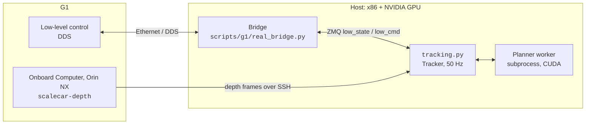

# Scalecar Vehicle Entry

This tutorial deploys the Scalecar d1146 vehicle-entry Tracker and Planner on the
Unitree G1 with sim2real's own runtime. It covers the machine layout, how to
generate the artifacts, how to check them in the vehicle sim2sim, and how to run
them on the robot.

Terms such as Tracker, Reference Source, File Playback, Planner, Hold, Go,
E-stop, Vehicle Scene, Task Envelope, Entry, Fall and Task Success are used as
defined in the
[glossary](https://github.com/dixiatielu/sim2real_scalecar/blob/main/GLOSSARY.md).
The design decisions behind this page are recorded in the ADRs:
[0001 Tracker rebuilt from ONNX](https://github.com/dixiatielu/sim2real_scalecar/blob/main/docs/adr/0001-tracker-weights-rebuilt-from-onnx.md),
[0002 sim2real state machine](https://github.com/dixiatielu/sim2real_scalecar/blob/main/docs/adr/0002-sim2real-state-machine-instead-of-scalecar-safety-layer.md),
[0003 Host runs Tracker and Planner](https://github.com/dixiatielu/sim2real_scalecar/blob/main/docs/adr/0003-host-runs-tracker-and-planner.md),
and [0004 vehicle sim2sim](https://github.com/dixiatielu/sim2real_scalecar/blob/main/docs/adr/0004-vehicle-sim2sim-uses-scalecar-scene-and-physics.md).

:::warning
The Host-side and vehicle sim2sim commands on this page have been run. The
robot steps (depth capture on the Onboard Computer, the Bridge and the Tracker
on a real G1) have only been checked for syntax and flags so far; they have not
run on hardware yet.
:::

## Topology {#topology}



- The **Host** runs everything that computes: the Tracker loop
  (`sim2real/rl_policy/tracking.py`), the Bridge, and the Planner, which
  `tracking.py` starts as a subprocess on the GPU. A plan takes about 40 ms on
  an RTX-class GPU; there is no evidence that the Orin NX meets that budget
  (ADR-0003).
- The **Onboard Computer** only runs the RealSense depth capture program.
  `tracking.py` starts it over SSH and receives its frames through an SSH
  tunnel. Depth timestamps are mapped onto the Host's monotonic clock, so the
  Planner, the Tracker and depth share one clock.
- **Why `--robot-io zmq` and `real_bridge.py`.** sim2real's inline robot
  backend (`--robot-io inline`) and `real_bridge_cpp.py` use
  `unitree_interface`, which `pyproject.toml` declares for aarch64 only. On the
  x86 Host the Tracker therefore talks ZMQ to the Python Bridge
  `scripts/g1/real_bridge.py`, which uses `unitree_sdk2py` and relays robot
  state and commands over DDS. See [Robot I/O](/reference/robot-io).
- The operator stages are sim2real's own state machine, not Scalecar's C++
  safety layer (ADR-0002). There is no watchdog independent of the policy
  process, and nothing latches.

## Host Setup {#host-setup}

Run every command on this page from the repository root of this fork. Install
the root project with the G1 robot extra, which provides `unitree_sdk2py` for
the Bridge:

```bash
uv sync --frozen --extra inference-cpu --extra robot-g1
```

The Tracker runs on ONNX Runtime CPU (about 0.2 ms per step). The Planner uses
the CUDA build of torch from the root project. Check that it sees the GPU:

```bash
uv run --frozen python -c "import torch; print(torch.__version__, torch.cuda.is_available())"
```

Cache the G1 model files from Hugging Face once, with network access:

```bash
HF_HUB_OFFLINE=0 uv run --frozen python -c "from sim2real.config.robots import G1_CFG; print(G1_CFG.resolve_mjcf_path())"
```

Then set these variables in every shell that runs the commands below, and
persist the two `HF_HUB_*` exports in `~/.bashrc` (see `AGENTS.md`):

```bash
export HF_HUB_OFFLINE=1 HF_HUB_DISABLE_TELEMETRY=1 UV_FROZEN=1
unset PYTHONPATH   # only needed if ROS is sourced in this shell
```

- `HF_HUB_OFFLINE=1` and `HF_HUB_DISABLE_TELEMETRY=1` stop the runtime from
  making Hugging Face requests during deployment.
- `UV_FROZEN=1` makes `uv run` use `uv.lock` as it is. The lock also references
  aarch64-only wheels under `third_party/wheels/`, which this deployment does
  not download, so letting uv re-resolve would fail.

## Get the Artifacts {#get-the-artifacts}

### Why These Artifacts Are Not on Drive {#why-these-artifacts-are-not-on-drive}

`AGENTS.md` says that converted deploy artifacts live in the shared Google
Drive folder. The Scalecar artifacts are an **exception** to that rule:

- The Vehicle Scene is built from Scalecar's Isaac assets (the car USDs and its
  G1 model), which may not be redistributed.
- All inputs come from the **private** ModelScope repository
  `Hzzzz001/scalecar_v2`.

Uploading the outputs would redistribute both. Instead, every Host generates
them locally with this repository's scripts. The scripts check their
ModelScope inputs against pinned sha256 values and write to the gitignored
`checkpoints/scalecar_d1146/`. Never commit or upload anything in that
directory.

### Log In to ModelScope {#log-in-to-modelscope}

You need read access to `Hzzzz001/scalecar_v2`; ask its owner. Log in once, and
paste your access token when the command prompts for it. Do not pass the token
on the command line or write it into scripts, configs or logs.

```bash
uvx --from modelscope-hub==0.4.6 modelscope login
uvx --from modelscope-hub==0.4.6 modelscope download Hzzzz001/scalecar_v2
```

The download is about 3.8 GB and lands in
`~/.cache/modelscope/models/Hzzzz001--scalecar_v2/snapshots/master/`, which
is where the scripts below look by default. Check it with the repository's own
checksum files:

```bash
MS=~/.cache/modelscope/models/Hzzzz001--scalecar_v2/snapshots/master
(cd "$MS/assets" && sha256sum -c SHA256SUMS)
(cd "$MS/dp/d1146_v1" && sha256sum -c SHA256SUMS)
(cd "$MS/trackers/d1146_dpsd_ft" && sha256sum -c SHA256SUMS)
```

### Tracker {#tracker}

```bash
uv run --with torch==2.7.0 --index https://download.pytorch.org/whl/cpu \
  python scripts/export_scalecar_tracker_onnx.py --variant ft500ema ft1000ema
```

- ModelScope ships only `actor.onnx` and `deployment.json` for each Tracker.
  The script rebuilds the network from the ONNX weights and re-exports it in
  sim2real's conventions (ADR-0001). It needs torch 2.7.0, the version that
  produced the original ONNX, and refuses any other.
- Output: `checkpoints/scalecar_d1146/tracker/<variant>/` with `policy.onnx`,
  `policy.yaml`, a copy of `deployment.json`, and `comparison.json`.
- Every export is compared with the original ONNX on 256 random inputs. The
  run prints the maximum difference (about 2e-6); `comparison.json` records it
  and fails the export above 5e-6. The export is deterministic.
- Start with `ft500ema`; `ft1000ema` is the alternative (Scalecar's own
  recommendation).

### Motions {#motions}

```bash
uv run python -I scripts/scalecar/convert_motions.py --takes take1512 take0595 \
  --output-dir checkpoints/scalecar_d1146/motions
```

- This extracts the two takes from the verified tar and converts them into an
  any4hdmi dataset: `motions/manifest.json` and
  `motions/motions/take1512.npz`, `motions/motions/take0595.npz`.
- `python -I` keeps the current directory off `sys.path`, because the tar
  contents are treated as untrusted.
- Point `--motion-path` at a Motion **file**. With the dataset root,
  `tracking.py` silently uses only its first Motion.

### Vehicle Scene {#vehicle-scene}

Only the vehicle sim2sim needs this step; the robot run does not.

```bash
uv run --script scripts/scalecar/build_vehicle_scene.py --out checkpoints/scalecar_d1146/scene
```

- The script rebuilds Scalecar's car scene from the ModelScope tars with
  Scalecar's own builder, then keeps only the collision hulls inside the Task
  Envelope (ADR-0004). Its USD toolchain is declared inline in the script and
  never enters the root project. uv prints a warning that `--frozen` is ignored
  for the script; that is expected.
- It takes about 12 minutes and peaks around 8 GB of RAM.
- Output: `scene/vehicle_scene.mjb` and `scene/build.json`. The build is
  deterministic: the MJB's sha256 is
  `19cf99deef53a2d34b49c8b093ae15c72a06c80fb6a6eca0a70243c824a543d5`.
- The MJB loads only in MuJoCo 3.11.0, which the root project pins. A MuJoCo
  upgrade means rebuilding the scene.
- `--work-dir DIR` keeps the full rebuild (about 0.9 GB). A later run with the
  same inputs only re-crops, in about 20 s, for example with another `--margin`.

### Planner Checkpoint {#planner-checkpoint}

The Planner checkpoint needs no conversion. It is read straight from the
ModelScope cache, `$MS/dp/d1146_v1/ckpt_40000.pt`, and pinned in
`sim2real/planner/checkpoint.py` by `CHECKPOINT_SHA256`
(`d5e12b4a1fd27ad2eeb0d3a4cbd33aeb1715c8fe0b24472032fe49693429863c`). Both the
vehicle sim2sim and `tracking.py` hash the file before loading it, refuse a
mismatch, and then load it with `torch.load(weights_only=True)`.

To use another file, pass `--planner-checkpoint <path>` (both CLIs accept it)
and set its hash in the policy YAML under `motion.planner.checkpoint_sha256`.

### Resulting Layout {#resulting-layout}

```text
checkpoints/scalecar_d1146/
  tracker/ft500ema/   policy.onnx  policy.yaml  deployment.json  comparison.json
  tracker/ft1000ema/  (same files)
  motions/            manifest.json  motions/take1512.npz  motions/take0595.npz
  scene/              vehicle_scene.mjb  build.json
  sim2sim/            vehicle sim2sim results (next section)
```

## Vehicle Sim2Sim {#vehicle-sim2sim}

The vehicle sim2sim runs Scalecar's scene, G1 model and physics, with sim2real's
unchanged `tracking.py` runtime as the Tracker (ADR-0004). Each Tracker × Motion
pair is one case, and each case runs in its own process.

- **File Playback episode.** The Tracker takes over at t = 0 (Shaping is not
  simulated), Holds for 5 s (`--hold-s`), then Go plays the Motion, followed by
  a 2 s Final Hold (`--final-hold-s`).
- **Planner episode.** The Tracker Holds for 5 s (`--hold-s`), then Go starts planning, and
  the episode ends 40 s after Go (`--planner-s`). Depth is rendered from the
  scene at 30 Hz. The simulation runs on simulated time, and each plan's
  measured latency is injected, so a slow plan arrives late in the simulation
  as it would on the robot.

### File Playback {#file-playback}

```bash
uv run python -m sim2real.sim_env.vehicle_sim2sim \
  --trackers ft500ema ft1000ema --motions take1512 take0595
```

- The four cases run in parallel. `--workers` defaults to the number of cases,
  capped at the number of physical performance cores; each episode uses one
  CPU core. A take1512 episode takes about 60 s of wall time.
- `--trackers` and `--motions` accept names (`ft500ema`, `take1512`) or paths
  (`.../policy.yaml`, `.../take1512.npz`).

### Planner {#planner}

```bash
uv run python -m sim2real.sim_env.vehicle_sim2sim \
  --trackers ft500ema --motions take1512 take0595 --reference-source planner
```

- This needs a CUDA GPU and EGL for offscreen depth rendering; the runner sets
  `MUJOCO_GL=egl` itself.
- Planner cases run **one at a time** by default (`--workers 1`). Keep it that
  way. Parallel episodes share the GPU, which inflates every plan's latency,
  and the sim injects that latency into the episode:

  | parallel episodes | latency p50 / p95 | late Chunks per episode |
  | --- | --- | --- |
  | 1 | 38–39 / 40 ms | 0 |
  | 2 | 41–42 / 45–46 ms | 0 |
  | 4 | 50–51 / 65–69 ms | 0–1 |

- A 45 s episode takes about 130 s of wall time.
- Planner runs are not bitwise repeatable, by design: the measured latency
  changes from run to run, so Entry times can differ by a few tenths of a
  second.

### Reading the Results {#reading-the-results}

Results go to `checkpoints/scalecar_d1146/sim2sim/` unless you pass
`--output-dir`. Use a separate directory to keep an earlier run, for example
`--output-dir checkpoints/scalecar_d1146/sim2sim_rerun`.

- Per case: `<tracker>_<take>.json` (the result), `.rollout.npz` (per-tick
  state, joint targets and envelope margin) and `.log`. Planner cases end in
  `_planner`.
- Per run: `summary.json`, or `summary_planner.json` with the Planner.
- The terminal prints one line per case:

  ```text
  ft500ema_take1512: task_success=True entry=8.52 s fallen=False termination=completed valid min_margin=0.154 m wall=62 s
  ```

- The exit status is 0 only if every case reached Task Success and is valid.

The main fields of the result JSON:

| field | meaning |
| --- | --- |
| `task_success` | Entry, no Fall, and the episode ran to completion. It does **not** include `valid`; check both. |
| `entered`, `entry_time_s` | Entry: both feet and the pelvis inside the cabin region for 0.75 s. The time is counted from Go. |
| `fallen`, `fall_time_s` | Fall: pelvis or torso too low, or body tilted too far, for 0.2 s. The episode stops at a Fall. |
| `termination` | `completed`, `fall_detected`, `fall_during_hold`, `nonfinite_state`, or `go_refused` (Planner). |
| `valid`, `invalid_reason`, `envelope` | The Task Envelope check: `threshold_m`, `min_margin_m`, `closest` and `first_violation` (time, margin, geom, body). |
| `timeline` | Simulated times: `go_time_s`, `end_time_s`, `ticks`, and the Hold settings. |
| `planner` | Planner cases only: `latency_ms` (p50/p95/p99/max), `late_chunks`, `coverage_exhausted_events`, `coverage_exhausted_ticks`, `first_chunk_delay_s`, `go_initialization.height_m`, plan counts, the checkpoint and its sha256. |
| `wall` | Wall-clock cost: `per_tick_ms`, `realtime_factor`. |

For example, with `jq`:

```bash
jq '.cases' checkpoints/scalecar_d1146/sim2sim/summary_planner.json
jq '{task_success, valid, entry_time_s, latency_ms: .planner.latency_ms.p50, late_chunks: .planner.late_chunks}' \
  checkpoints/scalecar_d1146/sim2sim/ft500ema_take0595_planner.json
```

### The Task Envelope Warning {#the-task-envelope-warning}

The Vehicle Scene keeps the car's collision geometry only inside the Task
Envelope: the region that all 1146 Motions reach, plus 0.3 m. Outside it the car
has no collision geometry, so a robot that gets there would pass through parts
of the car that the real car has. Every tick, the runner measures how close the
robot's collision geometry comes to the envelope boundary. Below 0.1 m it marks
the episode invalid and prints one warning, for example:

```text
[ft500ema_take1512] WARNING: Invalid episode: left the Task Envelope. head_collision (torso_link) is 0.087 m from the boundary at t=11.10 s (threshold 0.10 m)
```

The episode keeps running and still reports Entry and Fall, but `valid` is
`false`, the summary line says `INVALID (left the Task Envelope)`, and the exit
status is 1. Do not use such a result. New Motions or start positions need a new
envelope: rebuild the scene (with `--work-dir`, re-cropping takes about 20 s).
In the accepted runs the closest approach is about 0.15 m.

## Acceptance Before the Robot {#acceptance-before-the-robot}

The maintainer's acceptance rule, with ft500ema in the vehicle sim2sim:

- **File Playback.** take1512 must reach Task Success. take0595 only has to
  match Scalecar's own result for the same case: no Entry, no Fall, and a valid
  episode. File Playback runs therefore exit with status 1 because of take0595;
  that is expected.
- **Planner.** take0595's Entry is accepted through the Planner: with the
  Planner, take1512 and take0595 must both reach Task Success and be valid.
- **Serial Planner runs.** Run Planner acceptance one episode at a time,
  because GPU contention inflates the injected latency.

Recorded results (the Planner ranges cover three runs):

| case | Task Success | Entry (from Go) | Fall | valid / min margin |
| --- | --- | --- | --- | --- |
| File Playback, ft500ema, take1512 | yes | 8.52 s | no | yes / 0.154 m |
| File Playback, ft500ema, take0595 | no (no Entry; same as Scalecar) | – | no | yes / 0.152 m |
| File Playback, ft1000ema, take1512 | yes | 8.54 s | no | yes / 0.155 m |
| File Playback, ft1000ema, take0595 | no (no Entry; same as Scalecar) | – | no | yes / 0.149 m |
| Planner, ft500ema, take1512 | yes | 7.58–7.62 s | no | yes / 0.153–0.154 m |
| Planner, ft500ema, take0595 | yes | 8.76–8.98 s | no | yes / 0.146–0.149 m |

The Planner runs had a latency p50 of about 38–39 ms, no late Chunks and no
coverage exhaustion. With File Playback, ft500ema on take0595 ends with the left foot
about 2.6 cm outside the cabin region, in both sim2real and Scalecar's runtime.

If a case fails, run the same case with Scalecar's own
`tools/deploy/test_dp_mujoco.py` (in a Scalecar_v2 checkout) to tell a case that
fails on its own from a bug introduced by the port.

## Depth Capture on the Onboard Computer {#depth-capture-on-the-onboard-computer}

### Prerequisites {#prerequisites}

- **Key-based SSH from the Host user.** `tracking.py` starts the capture program
  with `ssh -o BatchMode=yes`, which cannot answer any prompt. Copy your key
  once (this also accepts the host key), then check that the second command
  succeeds without a prompt:

  ```bash
  ssh-copy-id unitree@192.168.123.164
  ssh -o BatchMode=yes unitree@192.168.123.164 true
  ```

  Run `ssh-keygen -t ed25519` first if you have no key. `--depth-ssh-host` may
  also be an alias from `~/.ssh/config`, for a different user or port.
- **librealsense2 and zlib development files** on the Onboard Computer. The G1
  is documented to ship librealsense 2.50.0 under `/opt/ros/noetic`; this has
  not been verified yet. Check:

  ```bash
  ssh unitree@192.168.123.164 'dpkg -l | grep realsense; ls /opt/ros/noetic/include/librealsense2; cmake --version'
  ```

### Build {#build}

Copy the sources and build them on the Onboard Computer:

```bash
rsync -a scripts/g1/depth_stream/ unitree@192.168.123.164:~/sim2real_depth_stream/
ssh unitree@192.168.123.164 'cd ~/sim2real_depth_stream && ./build.sh'
```

- `build.sh` builds and runs the clock test, then builds
  `build/scalecar-depth` with g++. It does not need CMake: `CMakeLists.txt`
  needs CMake 3.18, and JetPack 5 ships 3.16.
- If librealsense2 is installed elsewhere, set `REALSENSE_PREFIX` (default
  `/opt/ros/noetic`) or `REALSENSE_LIBDIR`.
- If `rsync` is missing, use `scp -r scripts/g1/depth_stream unitree@192.168.123.164:~/sim2real_depth_stream`
  while `~/sim2real_depth_stream` does not exist yet.
- The result, `/home/unitree/sim2real_depth_stream/build/scalecar-depth`, is the
  Host's default `--depth-remote-executable`.

Nothing else runs on the Onboard Computer. `tracking.py` starts and stops the
capture program itself. If reconnects keep failing with "Cannot bind depth
listener", an old capture process may still hold the port; check with
`ssh unitree@192.168.123.164 pgrep -a scalecar-depth`.

## Run on the Robot {#run-on-the-robot}

Connect the Host to the G1 over Ethernet with an address on `192.168.123.x`, as
in [Network Configuration](/getting-started/network-configuration). Find the
interface name with `ip -br link`. Place the robot where the Motion starts:
behind the open driver door, in the Motion's first-frame pose. Both terminals
need the exports from [Host Setup](#host-setup).

Terminal 1, the Bridge. It releases the robot's built-in motion mode when it
starts:

```bash
uv run scripts/g1/real_bridge.py --interface <host_ethernet_interface>
```

Terminal 2, the Tracker with the Planner as Reference Source:

```bash
uv run sim2real/rl_policy/tracking.py \
  --policy-config checkpoints/scalecar_d1146/tracker/ft500ema/policy.yaml \
  --motion-path checkpoints/scalecar_d1146/motions/motions/take1512.npz \
  --motion-backend planner --robot-io zmq --controller keyboard \
  --depth-ssh-host unitree@192.168.123.164 \
  --depth-remote-executable /home/unitree/sim2real_depth_stream/build/scalecar-depth
```

Or with File Playback, which needs no depth:

```bash
uv run sim2real/rl_policy/tracking.py \
  --policy-config checkpoints/scalecar_d1146/tracker/ft500ema/policy.yaml \
  --motion-path checkpoints/scalecar_d1146/motions/motions/take1512.npz \
  --motion-backend npz --robot-io zmq --controller keyboard
```

- The Reference Source is fixed for the whole run (`--motion-backend`).
- `--motion-path` is required in both modes. Its first frame is the Shaping
  target and the Hold Reference.
- `--controller joystick` reads the Unitree joystick on the hard-coded
  interface `eth0`. If the Host's robot interface has another name, use the
  keyboard.
- Ctrl+C stops `tracking.py`. With the Planner, the worker subprocess prints a
  `KeyboardInterrupt` traceback; it is harmless.

### Operator Keys: A → R1 → B → R2 {#operator-keys}

| key | keyboard / joystick | stage | File Playback | Planner |
| --- | --- | --- | --- | --- |
| A | `i` / A | Shaping | Moves to the Motion's first-frame pose, clipped to the soft joint limits. | Same. Also drops an active Go. |
| R1 | `]` / R1 | Tracker takes over: Hold | The Reference is frozen at the Motion's frame 0. | Same. Also drops an active Go, so R1 always means Hold. |
| B | space / B | Go | Toggles play/pause. The first press plays the Motion; at its end the Tracker stays in Final Hold. | Only in Hold. The first press requests Go, which is checked at the next tick (pelvis height, depth age, Planner warmup). If refused, the robot stays in Hold and you can press B again. If accepted, Hold lasts until the first Chunk, then the Planner drives the Reference. Further presses are ignored. During Shaping or E-stop, B is ignored with a warning. |
| R2 | `o` / R2 | E-stop | Every joint target follows its measured position. | Same. Also drops the Go. Restart with A → R1 → B. |

The Pico Controller has no B (its B is E-stop), so with the Planner, Go comes
from the keyboard or the Unitree joystick only.

### Terminal Messages with the Planner {#terminal-messages-with-the-planner}

At startup:

```text
Planner depth: starting /home/unitree/sim2real_depth_stream/build/scalecar-depth on unitree@192.168.123.164 through SSH (local port 18742); logs in outputs/planner_depth/<time>
Depth: first frame received (0.032 s old)
```

The capture program publishes nothing for its first 12 s, so expect the first
frame about 13–15 s after start. Go is refused until depth is at most 0.2 s old.

On Go:

```text
Planner: Go requested via keyboard:space
Planner: Go accepted. Pelvis height 0.789 m (feet 0.789 / 0.789 m); Hold until the first Chunk
Planner: first Chunk applied 0.060 s after Go
```

or `Planner: Go refused, staying in Hold: <reason>`, where the reason is the
pelvis height check, an unfinished Planner warmup, stale depth (`depth is
0.350 s old (limit 0.2 s)`), or a depth or worker error. Standing pelvis height
at Go is about 0.79 m in the vehicle sim2sim. An E-stop, Shaping or a new R1
prints `Planner: Go dropped (...)`; the Planner then runs a fresh warmup plan,
which the next Go waits for. If the worker crashed, that warmup is answered once
it has restarted.

Every 5 s after Go, a stats line reports the plan count, latency p50/p95, late
Chunks, coverage exhaustion, depth age and the Planner phase.

Depth problems are printed when they start, at most once per second while they
last, and when they end. The Planner keeps planning from the last frame, with
its real age:

- `Depth stale: last frame is 0.206 s old (limit 0.2 s); ...`, then
  `Depth still stale: ...`, then `Depth recovered after 1.5 s stale: ...`.
- `Depth camera disconnected (...); the receiver keeps reconnecting: <error>`,
  then `Depth camera still disconnected (...)`, then
  `Depth camera reconnected after 5.4 s (new session, depth history cleared); ...`.
- A stalled stream shows "still stale" for 30 s, then the disconnect messages.

The depth logs are in `outputs/planner_depth/<time>/` (or `--depth-log-dir`):
`depth_source.log` (the capture program's stderr), `depth_clock.json` (the
Host–Onboard clock sync; its `uncertainty_s` should be at most 0.01) and
`depth_summary.json`.

## Next Steps {#next-steps}

- [Robot I/O](/reference/robot-io)
- [Tracking Framework](/reference/tracking-framework)
- [Glossary](https://github.com/dixiatielu/sim2real_scalecar/blob/main/GLOSSARY.md)
